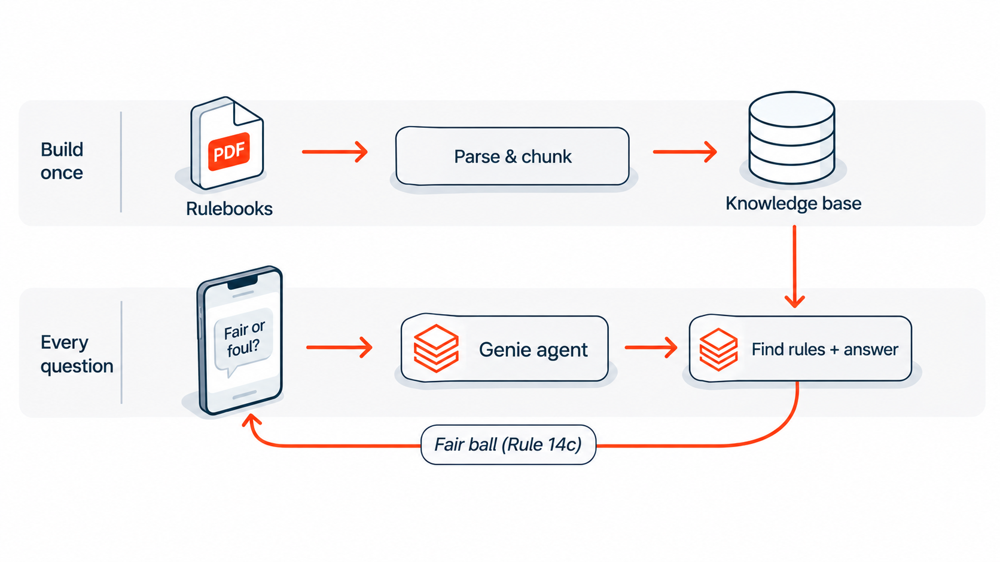

# databricks-teeball-agent

A teeball umpire rules assistant on Databricks. Rulebook PDFs go in, a Genie agent comes out that you can ask from the Databricks mobile app mid-game: "Runner leaves 1st on the hit and the ball is caught - out?" → ruling plus rule and page citations.

- Built on **Databricks Free Edition**, deployed entirely with **Declarative Automation Bundles (DABs)**.
- **Nothing always-on:** serverless jobs, pay-per-token models, no Vector Search endpoint.
- **Evaluation-first:** every change is measured against trusted answers (15 real-game rulings + 301 generated questions).

Sources: TBAWA (Teeball Association of Western Australia) Official Rule Book Ed 8, TBAWA Annotated Rule Book & Umpire Manual 7A, and Wembley Tee-Ball Association (WTBA) By-Laws July 2026.



## How it works

1. **Ingest** (`ingest_rulebooks` job): PDFs in `knowledge/rulebooks/` are synced with the bundle and copied to a Unity Catalog volume.
2. **Parse & chunk:** `ai_parse_document`, then one chunk per rule/section, each prefixed with document, rule number and pages. Only new or changed PDFs are re-parsed.
3. **Embed:** `databricks-gte-large-en` embeddings stored in a Delta column (`rule_chunks`), plus IDF keyword weights (`rule_terms`).
4. **Answer:** SQL function `ask_rulebook(question)` embeds the question, ranks chunks in plain SQL (cosine + keyword overlap + rule-number boost), takes the top 5 per document, and asks `databricks-gpt-oss-120b` to answer with citations using `src/prompts/answer_rules_v3.md`.
5. **Agent:** Genie agent "Teeball Umpire" calls `ask_rulebook` via a parameterised example SQL. Its only table is `documents` (titles, no rule text), so it can't bypass the function with its own keyword query. Genie One (web + mobile) routes teeball questions to it.

## Prerequisites

- Databricks workspace with Unity Catalog and serverless (Free Edition works).
- Databricks CLI **v1.26+** (for the `genie_spaces` bundle resource).
- A CLI profile named `teeball`:
  ```sh
  databricks auth login --host https://<your-workspace>.cloud.databricks.com --profile teeball
  ```
- A SQL warehouse named "Serverless Starter Warehouse" (Free Edition default) or override `warehouse_id`.
- For prod: a workspace group for business users (default `business_us`, override with `--var business_group=<name>`). It gets CAN_RUN on the agent, EXECUTE on `ask_rulebook` and SELECT on `documents` only; the function reads `rule_chunks` with its owner's rights.

## Deploy

```sh
databricks bundle deploy -t prod                 # dev (default) prefixes names and stays owner-only
databricks bundle run -t prod ingest_rulebooks   # parse, chunk, embed, create ask_rulebook
```

Then open the "Teeball Umpire" agent in your home folder, or ask Genie One. A new agent can take a few hours to appear in Genie One chat routing; opening it directly works immediately.

Quick test from SQL:
```sql
SELECT workspace.teeball.ask_rulebook('Ball first lands fair then rolls foul before 3rd. Fair or foul?');
```

## Add a document

1. Drop the PDF in `knowledge/rulebooks/`.
2. Add an entry to `knowledge/documents.json` (`title`, `doc_type`, `edition`, `authority_rank`; lower rank wins on conflict).
3. `databricks bundle deploy -t prod && databricks bundle run -t prod ingest_rulebooks`

Documents with their own numbering (e.g. `doc_type: bylaws`) are labelled separately so "Rule 17" never matches "By-Law 17".

## Evaluate

```sh
# Answer quality: LLM judge (Llama 4 Maverick) vs trusted answers -> eval_runs table
databricks bundle run -t prod eval_rulings --params "label=my-change"
databricks bundle run -t prod eval_rulings --params "label=my-change,evals_file=opus.json"

# Compare models / retrieval modes ('|' separates values; --params splits on commas)
databricks bundle run -t prod eval_rulings --params "label=models,models=databricks-gpt-oss-120b|databricks-meta-llama-3-3-70b-instruct"

# Retrieval only (did the right rule reach the model?) -> retrieval_runs table
databricks bundle run -t prod eval_retrieval --params "label=my-change"

# End to end through the deployed agent (Genie Conversation API): did it call ask_rulebook? -> genie_runs table
databricks bundle run -t prod eval_genie --params "label=my-change"
```

Experiments run through temporary functions, so the live agent isn't touched. Empty answers are marked WRONG before judging.

- `evals/rulings.json`: 18 questions from real games, answers checked against the rulebooks.
- `evals/opus.json`: 301 questions written by Claude Opus 5.5 reading both full TBAWA documents, spot-checked by an umpire.

**Current results** (301 questions): ~75% correct, ~5% wrong, rule cited in 99% of answers. Rulings set: 12 correct / 5 partial / 1 wrong. The build log in `docs/build-notes.md` covers every iteration and what moved the numbers.

## Layout

| Path | What |
|---|---|
| `databricks.yml` | Bundle, variables, dev/prod targets, prod permissions |
| `resources/` | Schema + volume, ingest job, evaluation jobs, Genie agent |
| `src/jobs/` | Copy PDFs, parse/chunk/embed, create function, evaluation jobs |
| `src/jobs/rag_sql.py` | Shared SQL template for `ask_rulebook` (retrieval modes, answer/retrieval output) |
| `src/prompts/` | Answer prompts (v1-v3), question-generation prompt |
| `knowledge/` | Source PDFs, extracted text, document metadata |
| `evals/` | Evaluation sets |
| `docs/` | Build notes, evaluation review, architecture diagram |
| `CLAUDE.md` | The original local Claude Code setup: rule summary + rulings log |

## Limitations

- Answers are a second opinion for volunteer umpires, not an official ruling. The umpire's call stands.
- Free Edition has no Claude models and no Genie file search; the answering model is GPT-OSS-120B.
- Brute-force similarity in SQL suits thousands of chunks, not millions.

## License

Code: MIT (see `LICENSE`). The rulebooks and by-laws in `knowledge/` belong to TBAWA and WTBA; they're publicly available from those associations and included here for convenience only, not covered by the MIT license.
